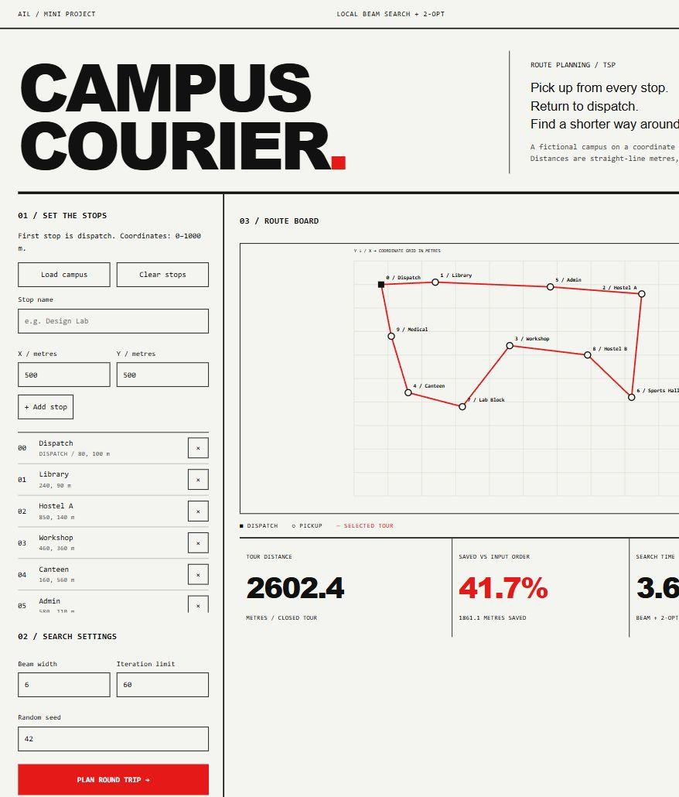

# Campus Courier Route Planner

An intermediate Artificial Intelligence Laboratory mini-project based on the Traveling Salesman Problem (TSP). A single courier visits every pickup point once and returns to dispatch. Local Beam Search uses swap successors; 2-opt then improves the best tour.

## Run

Install Python 3.10 or newer. No third-party packages, API keys, or internet connection are needed to run the app.

1. Open a terminal in this folder.
2. Run `python server.py` (on Windows, `py server.py` also works).
3. Open http://127.0.0.1:8765 in a browser.
4. Click **Plan round trip**. Compare the four routes using the route selector.

Keep the terminal open. Press Ctrl+C to stop. If the port is occupied, run `python server.py --port 8766` and open http://127.0.0.1:8766 instead.

## Use

The ten-stop campus loads on startup. Add or remove stops, or clear the list to enter your own. The first stop is dispatch. Coordinates use metres in a fictional flat campus; they are not geographic coordinates or measured road distances. Deleting dispatch makes the next stop the new dispatch. Input order is the unplanned baseline.

Beam width is 1–12, the iteration limit is 1–150, and the random seed is 0–999999. The seed reproduces initial tours. Timings can differ between runs. The optimizer supports 3–25 stops. An exhaustive exact reference runs automatically only for 3–9 stops, after the heuristic timing is recorded.

The output includes a closed tour, leg distances, comparison, convergence graph, savings against input order, and a downloadable JSON record. Stops exist in the current browser page only; use the export before closing or reloading.

## Files

- `tsp.py`: main Local Beam Search and 2-opt algorithms.
- `tour_utils.py`: distance matrix, closed-tour cost, canonical tours and nearest neighbor.
- `solver.py`: input validation, orchestration, exact reference and terminal demonstration.
- `server.py`: local HTTP server and JSON endpoints.
- `static/`: complete browser interface.
- `tests/test_solver.py`: algorithm correctness and input validation checks.

Run tests from this folder with `python -m unittest discover -s tests -v`. Run the terminal demonstration with `python solver.py`.

## Scope

This is a symmetric Euclidean TSP demonstration. It does not model roads, obstacles, traffic, time windows, parcel capacity, multiple couriers, or one-way travel. Beam search and 2-opt are heuristics: larger cases are not claimed to be globally optimal. Higher limits may take longer.

## Design source

The interface follows the Swiss Industrial Print direction in `industrial-brutalist-ui` from https://github.com/Leonxlnx/taste-skill, pinned at `a60a36dc2bb3bb77ccf17f2f62041f5ca8a458b9`. Interface copy was reviewed using the installed Avoid AI Writing rules.
